<picture>
  <source media="(prefers-color-scheme: dark)" srcset="assets/banner-dark.svg">
  
</picture>

<p align="center">
  <b>I like to make stuff — particularly when it comes to my homelab.</b><br>
  <a href="https://hello.errornoslash.be">website</a> · <a href="https://blog.errornoslash.be">blog</a> · <a href="https://contact.errornoslash.be">contact</a> · <a href="https://gitlab.com/ErrorN0Slash">gitlab</a> · <a href="https://mastodon.social/@slashy">mastodon</a>
</p>

<p align="center">
  <picture>
    <source media="(prefers-color-scheme: dark)" srcset="assets/terminal-dark.svg">
    
  </picture>
</p>

---

## 📌 Sites

Every site is hand-made: vanilla HTML, CSS and JavaScript, no build step, black and white.

| #  | site        | live                                                   | source                                                    |
| -- | ----------- | ------------------------------------------------------ | --------------------------------------------------------- |
| 01 | **hello**   | [hello.errornoslash.be](https://hello.errornoslash.be)     | [portfolio](https://github.com/ErrorNoSlash/portfolio) |
| 02 | **contact** | [contact.errornoslash.be](https://contact.errornoslash.be) | [Contact](https://github.com/ErrorNoSlash/Contact)     |
| 03 | **blog**    | [blog.errornoslash.be](https://blog.errornoslash.be)       | [blog](https://github.com/ErrorNoSlash/blog)           |
| 04 | **docs**    | coming soon                                            | [docs](https://github.com/ErrorNoSlash/docs)              |

## ❄️ Off GitHub

My NixOS config lives on GitLab: **[SlashyOS](https://gitlab.com/nixos-projects/slashyos)** — one flake for an AMD desktop and a Framework laptop, with niri and Noctalia on top and Stylix colouring everything from a single wallpaper. CI lints, formats and evaluates both hosts on every push.

## 📝 now.txt

```console
$ cat now.txt
building    the docs site, empty for now
tinkering   SlashyOS: mirroring to a second screen for presentations
writing     on the blog, about the things I make
```

<details>
<summary>🛠️ How this README works</summary>

<br>

No widgets, no third-party cards. The banner and the terminal are hand-written SVGs, animated with SMIL and a little CSS, in a dark and a light version that follow your system theme, just like the sites.

| piece        | what moves                                                                        |
| ------------ | --------------------------------------------------------------------------------- |
| **banner**   | the DS dots pop in and flicker, the prompt types the tab-title commands, the title glitches, the marquee scrolls |
| **terminal** | types five commands and prints their output, then starts over                     |

They're generated by [`build.py`](build.py): change `COMMANDS`, `SESSION` or `MARQUEE` and run `python3 build.py`.

</details>

---

<p align="center">
  <code>©Dias Stas</code> · <a href="https://hello.errornoslash.be">Website</a> · <a href="https://blog.errornoslash.be">Blog</a> · <a href="https://contact.errornoslash.be">Contact</a> · <a href="https://gitlab.com/ErrorN0Slash">GitLab</a> · <a href="https://mastodon.social/@slashy" rel="me">Mastodon</a>
</p>
