<picture>
  <source media="(prefers-color-scheme: dark)" srcset="assets/banner-dark.svg">
  
</picture>

  <picture><source media="(prefers-color-scheme: dark)" srcset="assets/tagline-dark.svg"></picture>

  <a href="https://hello.errornoslash.be"><picture><source media="(prefers-color-scheme: dark)" srcset="assets/footer-website-dark.svg"></picture></a>
  <a href="https://blog.errornoslash.be"><picture><source media="(prefers-color-scheme: dark)" srcset="assets/footer-blog-dark.svg"></picture></a>
  <a href="https://contact.errornoslash.be"><picture><source media="(prefers-color-scheme: dark)" srcset="assets/footer-contact-dark.svg"></picture></a>
  <a href="https://gitlab.com/ErrorN0Slash"><picture><source media="(prefers-color-scheme: dark)" srcset="assets/footer-gitlab-dark.svg"></picture></a>
  <a href="https://mastodon.social/@slashy" rel="me"><picture><source media="(prefers-color-scheme: dark)" srcset="assets/footer-mastodon-dark.svg"></picture></a>

  <picture>
    <source media="(prefers-color-scheme: dark)" srcset="assets/terminal-dark.svg">
    
  </picture>

---

## 📌 Sites

  <a href="https://hello.errornoslash.be"><picture><source media="(prefers-color-scheme: dark)" srcset="assets/site-hello-dark.svg"></picture></a><a href="https://contact.errornoslash.be"><picture><source media="(prefers-color-scheme: dark)" srcset="assets/site-contact-dark.svg"></picture></a> <a href="https://blog.errornoslash.be"><picture><source media="(prefers-color-scheme: dark)" srcset="assets/site-blog-dark.svg"></picture></a><a href="https://docs.errornoslash.be"><picture><source media="(prefers-color-scheme: dark)" srcset="assets/site-docs-dark.svg"></picture></a>

## ❄️ Off GitHub

  <a href="https://gitlab.com/nixos-projects/slashyos"><picture><source media="(prefers-color-scheme: dark)" srcset="assets/off-github-dark.svg"></picture></a>

## 📝 now.txt

  <picture><source media="(prefers-color-scheme: dark)" srcset="assets/now-dark.svg"></picture>

🛠️ How this README works

 

No widgets, no third-party cards. The banner and the terminal are hand-written SVGs, animated with SMIL and a little CSS, in a dark and a light version that follow your system theme, just like the sites.

| piece        | what moves                                                                        |
| ------------ | --------------------------------------------------------------------------------- |
| **banner**   | the DS dots pop in and flicker, the prompt types the tab-title commands, the title glitches, the marquee scrolls |
| **terminal** | types five commands and prints their output, then starts over                     |
| **the rest** | the motd, site cards, `slashyos.md`, `now.txt`, the link buttons and the footer: they rise in once, the cursors blink |

They're generated by [`build.py`](build.py): change `COMMANDS`, `SESSION`, `MARQUEE`, `MOTD`, `SITES`, `now_txt` or `FOOTER` and run `python3 build.py`.

---

  <a href="https://contact.errornoslash.be"><picture><source media="(prefers-color-scheme: dark)" srcset="assets/footer-copy-dark.svg"></picture></a>
  <a href="https://hello.errornoslash.be"><picture><source media="(prefers-color-scheme: dark)" srcset="assets/footer-website-dark.svg"></picture></a>
  <a href="https://blog.errornoslash.be"><picture><source media="(prefers-color-scheme: dark)" srcset="assets/footer-blog-dark.svg"></picture></a>
  <a href="https://contact.errornoslash.be"><picture><source media="(prefers-color-scheme: dark)" srcset="assets/footer-contact-dark.svg"></picture></a>
  <a href="https://gitlab.com/ErrorN0Slash"><picture><source media="(prefers-color-scheme: dark)" srcset="assets/footer-gitlab-dark.svg"></picture></a>
  <a href="https://mastodon.social/@slashy" rel="me"><picture><source media="(prefers-color-scheme: dark)" srcset="assets/footer-mastodon-dark.svg"></picture></a>

